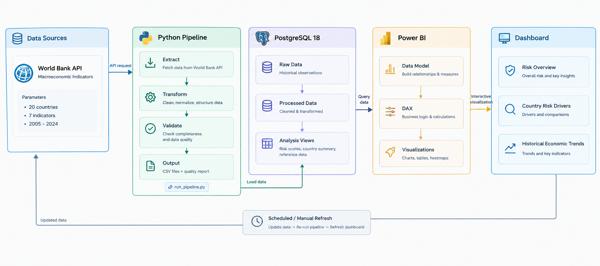

# Emerging Markets Intelligence & Risk Monitor

**Macroeconomic data pipeline and country-risk analytics using Python, PostgreSQL, and Power BI.**

This project collects World Bank indicators for 20 selected emerging and developing economies, processes and validates the observations, loads the cleaned data into PostgreSQL, and presents cross-country comparisons and historical trends in Power BI.

The analysis covers **2005–2024** for historical trends and uses **2020–2024** as the baseline period for the relative risk score.

> **Interpretation note:** The risk score is an exploratory, peer-relative screening metric. It is not an official sovereign rating, a probability of crisis, a forecast, or investment advice.

## What this project answers

- How do selected economies compare on relative macroeconomic vulnerability?
- Which risk components are most prominent for a selected country?
- How have key macroeconomic indicators changed over time?

## Data pipeline



The pipeline follows a straightforward sequence:

1. **World Bank Indicators API** — retrieve annual observations for the selected countries and indicators.
2. **Extract and validate** — Python scripts collect API responses and check coverage and data integrity.
3. **Transform** — standardize the observations, indicator labels, and output structure.
4. **Load to PostgreSQL** — upsert cleaned observations into the analytical database.
5. **Power BI** — use the database outputs to explore relative risk and historical indicator trends.
6. **Scheduled execution** — Windows Task Scheduler can launch the pipeline periodically; timestamped logs help verify each run.

The illustration is a high-level data-flow overview. The detailed implementation lives in `run_pipeline.py` and the `src/` directory.

## Dashboard

The Power BI report is organized into three pages:

| Page | Purpose |
|---|---|
| **Risk Overview** | Compare relative risk scores and identify countries that stand out within the peer group. |
| **Country Risk Drivers** | Examine a selected country's score, rank, component profile, and peer comparison. |
| **Historical Economic Trends** | Explore annual movements in selected indicators and compare countries over time. |

The report file is located at `reports/powerbi/Emerging_Markets_Intelligence_Risk_Monitor.pbix`. Add genuine screenshots of each page to `screenshots/` if you want the repository landing page to showcase the report visually.

## Risk-scoring approach

The baseline scoring period is **2020–2024**. The score uses relative percentile-based component scores and the following weights:

| Component | Weight |
|---|---:|
| Inflation risk | 33.33% |
| External vulnerability (current account balance) | 33.33% |
| GDP growth risk | 16.67% |
| GDP growth volatility risk | 16.67% |
| **Total** | **100.00%** |

The model uses PostgreSQL `PERCENT_RANK()` to normalize indicator-level values across the selected country sample. Lower GDP growth and lower current-account balances correspond to higher risk; higher inflation and higher GDP growth volatility correspond to higher risk.

A score of 50 does **not** mean a 50% probability of crisis. The score is relative to the chosen country universe, period, indicators, transformations, and weights. FDI net inflows are retained as a supporting indicator rather than included in the composite score because their relationship with risk is not unambiguously positive or negative.

The historical heatmap on Page 3 uses separate, indicator-specific display rules. Those colors are exploratory visual cues, not part of the composite score or universal economic thresholds. See [Risk Scoring Methodology](docs/risk_scoring_methodology.md).

## Data coverage

- **Countries:** 20 selected economies across Asia, Latin America, Africa, and Europe.
- **Years:** 2005–2024.
- **Indicators:** GDP growth, GDP per capita growth, inflation, unemployment, current-account balance, FDI net inflows, and trade (% of GDP).
- **Primary source:** World Bank World Development Indicators API.

Indicator codes and units are maintained in [`data/reference/indicator_catalog.csv`](data/reference/indicator_catalog.csv), and the country universe is listed in [`data/reference/country_universe.csv`](data/reference/country_universe.csv).

## Technology stack

| Technology | Use |
|---|---|
| Python | Pipeline orchestration and data processing |
| `requests` | API requests |
| `pandas` | Data transformation and validation |
| `psycopg` | PostgreSQL connection and loading |
| PostgreSQL 18 | Persistent analytical storage and SQL analysis |
| Power BI | Interactive reporting |
| Windows Task Scheduler | Local scheduled execution |

## Repository structure

```text
.
├── README.md
├── requirements.txt
├── run_pipeline.py
├── run_pipeline_scheduled.bat
├── src/
│   ├── ingestion/
│   ├── transformation/
│   ├── validation/
│   └── database/
├── sql/
├── data/
│   ├── raw/                 # Downloaded/source extracts
│   ├── processed/           # Cleaned data and quality reports
│   └── reference/           # Country universe and indicator catalogue
├── docs/
│   ├── images/data-pipeline-overview.png
│   ├── automation.md
│   ├── dashboard_guide.md
│   ├── data_dictionary.md
│   ├── data_quality_and_limitations.md
│   ├── project_brief.md
│   └── risk_scoring_methodology.md
├── reports/powerbi/
└── screenshots/
```

## Run the pipeline

### Prerequisites

- Python installed on Windows.
- PostgreSQL 18 running locally or reachable through the configured connection.
- A database named `emerging_markets_intelligence` with the required `economic_observations` table and unique constraint on `(country_code, indicator_code, year)`.
- A PostgreSQL password supplied through the `PGPASSWORD` environment variable.
- Network access to the World Bank API.

### Setup

From the project root in PowerShell:

```powershell
py -m venv .venv
.\.venv\Scripts\Activate.ps1
python -m pip install --upgrade pip
pip install -r requirements.txt
```

Set database connection variables for the current PowerShell session (replace the values with your local settings):

```powershell
$env:PGHOST = "127.0.0.1"
$env:PGPORT = "5432"
$env:PGDATABASE = "emerging_markets_intelligence"
$env:PGUSER = "postgres"
$env:PGPASSWORD = "your-local-password"
```

Run:

```powershell
python run_pipeline.py
```

The pipeline runs these steps in order and stops if a step fails:

1. Extract data from the World Bank API.
2. Validate the extracted dataset.
3. Transform the dataset.
4. Validate the cleaned dataset.
5. Load observations into PostgreSQL.

Logs are written to `logs/`. Do not publish log files containing machine-specific details.

> **Database setup:** This repository contains analytical SQL scripts, but confirm that the target database has the required base table and unique constraint before running the loader. Do not assume a fresh PostgreSQL installation is ready without schema setup.

## Schedule automatic runs

See [Pipeline Automation](docs/automation.md) for Windows Task Scheduler instructions. The supplied batch file assumes the project is located at `%USERPROFILE%\Documents\emerging-markets-intelligence`; update that path if necessary.

Scheduling the Python pipeline updates the source data and PostgreSQL database. It does **not** automatically refresh Power BI Desktop. Refresh the PBIX separately after a successful pipeline run, or configure a separate Power BI Service refresh workflow.

## Data quality and limitations

- Data availability may vary by indicator, country, and year.
- Missing values must not be treated as zero.
- Source values can be revised by the World Bank.
- The country universe is selected for this project and does not represent every emerging market.
- Percentile-based scores change when the peer group or scoring period changes.
- Component weights are transparent modelling assumptions, not empirically proven optimal weights.
- The score has not been validated against historical crisis or sovereign default outcomes.
- Historical associations do not establish causality.

See [Data Quality and Limitations](docs/data_quality_and_limitations.md).

## Data sources

- [World Bank World Development Indicators](https://databank.worldbank.org/source/world-development-indicators)
- [World Bank Indicators API](https://api.worldbank.org/)

## Author

**Richard Yahya** · Information Systems

Areas of interest: Data Analytics, Business Intelligence, Business Analysis, and ERP.

- LinkedIn: `Add your LinkedIn URL`
- Portfolio: `Add your portfolio URL`
